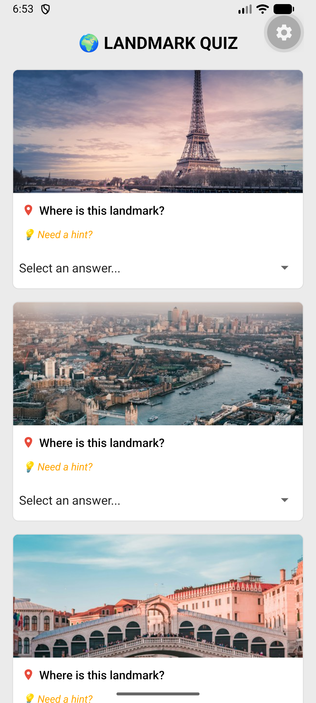
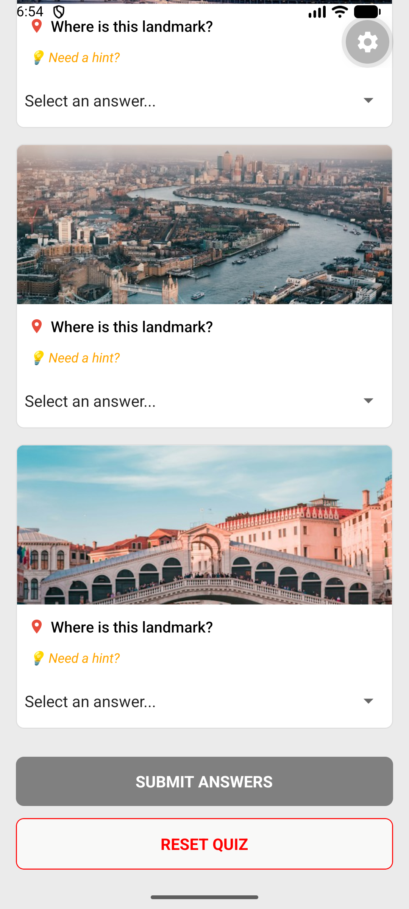

# Landmark Quiz App
A lightweight, interactive mobile application built with React Native designed to test users' knowledge of famous global landmarks. The app provides an engaging trivia experience with dynamic state tracking, instant user feedback, and a clean modular design.

# Modular Component Architecture:

Concept Applied: Component-Driven Development and Separation of Concerns. The app is split into two clean files (App.js for app-level state and logic, and QuestionCard.js for reusable UI layouts), making the codebase easy to maintain and scale.

# Dynamic Answer Tracking & State Management:

Concept Applied: React useState and Array Iteration (.map()). User inputs from dropdown pickers are tracked dynamically by index, updating the state safely without mutating original arrays.

# Native Feedback & Hint System:

Concept Applied: Native Device Integration (ToastAndroid and Alert). Users can tap a "Need a hint?" button to trigger instant, non-intrusive toast pop-ups containing custom hints for each landmark.

# Validation & Score Calculation:

Concept Applied: Conditional Logic and Array Filtering. The app checks if all questions have been answered prior to submission, calculates the final score by comparing user choices against correct answers, and displays the result through a native alert dialog.

# Quiz Reset Functionality:

Concept Applied: State Resetting. Allows users to clear all selected options instantly to restart the quiz from a clean slate, accompanied by native feedback confirmations.

# ScreenShots of App

Screenshots:  

# Demo Video

Demo Video Link:  
# Demo Video

<video src="./img/Screen Recording 2026-11-07 144940.mp4" controls width="100%">
  Your browser does not support the video tag.
</video>

